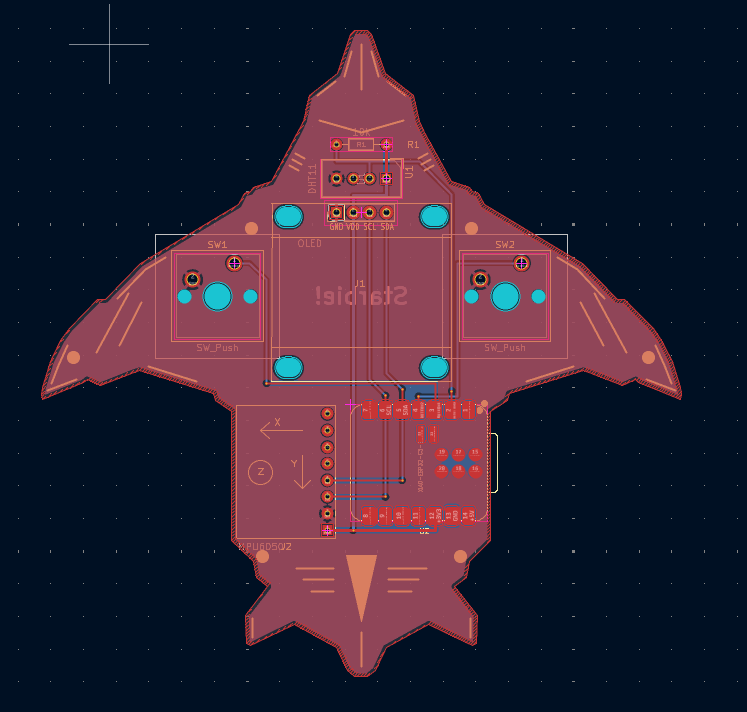
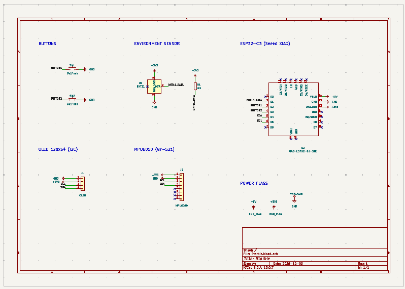

# Starbie

A small KiCad PCB project: a handheld board built around a Seeed XIAO ESP32-C3, with an I2C OLED display (128x64), an MPU6050 motion sensor (GY-521), and push buttons (Cherry MX switches).

## Schematic

## Bill of Materials

Full BOM with vendor links and notes: [Starbie_BOM.csv](Starbie_BOM.csv) (prices in USD, vendors in India).

| Part | Ref | Purpose | Qty | UNIT | Vendor |
| --- | --- | --- | --- | --- | --- |
| Seeed Studio XIAO ESP32C3 | U2 | Microcontroller (Wi-Fi, main loop) | 1 | 15.91 | [Amazon](https://www.amazon.in/dp/B0B94JZ2YF) |
| 0.96in 128x64 I2C OLED, 4-pin | J1 | Shows the pet and the menu | 1 | 1.68 | [Ktron](https://www.ktron.in/product/oled-display-i2c-0-96-inch/) |
| MPU6050 GY-521 accelerometer/gyro | J2 | Tilt to steer the menu, shake detection | 1 | 1.99 | [Ktron](https://www.ktron.in/product/mpu6050-module/) |
| DHT11 temperature/humidity sensor, bare 4-pin | U1 | Senses room temperature and humidity | 1 | 0.96 | [Ktron](https://www.ktron.in/product/dht11-temperature-and-humidity-sensor/) |
| MX-style mechanical keyboard switches | SW1, SW2 | The two buttons (menu and stats) | 1 pack | 8.28 | [Amazon](https://www.amazon.in/dp/B0G39H2G4H) |
| Blank MX keycaps | SW1, SW2 | Caps for the two buttons | 1 pack | 7.18 | [Amazon](https://www.amazon.in/dp/B0HD587C9N) |
| PCB fabrication, 2-layer FR4, 98.04x98.8 mm | | The bare Starbie board (Rs 2,166 for 5 boards, about Rs 433 each) | 1 order (5 boards) | 22.45 | [LionCircuits](https://www.lioncircuits.com/) |

## Contents

- `Starbie.kicad_sch` / `Starbie.kicad_pcb` / `Starbie.kicad_pro`: KiCad project files
- `libs/`: custom symbols, footprints and 3D models
- `gerbers/`, `Starbie_Gerbers.zip`: manufacturing outputs
- `Starbie_BOM.csv`: bill of materials with vendors and prices (India)
- `Starbie_CPL.csv`: component placement list for PCB assembly
- `renders/`: top and bottom board renders
