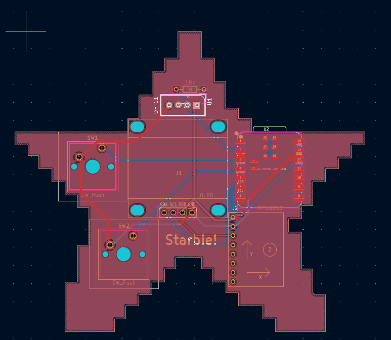

# Starbie

A small KiCad PCB project: a handheld board built around a Seeed XIAO ESP32-C3, with an I2C OLED display (128x64), an MPU6050 motion sensor (GY-521), and push buttons (Cherry MX switches).

## Contents

- `Starbie.kicad_sch` / `Starbie.kicad_pcb` / `Starbie.kicad_pro`: KiCad project files
- `libs/`: custom symbols, footprints and 3D models
- `gerbers/`, `Starbie_Gerbers.zip`: manufacturing outputs
- `renders/`: top and bottom board renders
